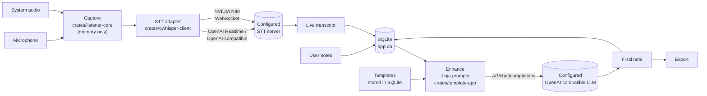

This page describes the current state of the Syntheo Desktop code, for developers and contributors. Syntheo Desktop is a fork of Anarlog (Fastrepl), distributed under the MIT license: the origin of the code is detailed in `NOTICE.md`.

## Monorepo overview

The repository is a **pnpm** monorepo (`pnpm-workspace.yaml`: `apps/*`, `packages/*`, `plugins/*`) paired with a **Cargo workspace** (`Cargo.toml`: `apps/cli`, `apps/desktop/src-tauri`, `crates/*`, `plugins/*`). It contains only two applications: the desktop client and the CLI.

| Role | Location | Contents |
| --- | --- | --- |
| Desktop app | `apps/desktop` | Tauri 2. React 19 interface in TypeScript, built with Vite. Routing, queries, and forms with TanStack (Router, Query, Form), local state with Zustand. The native core is in `apps/desktop/src-tauri`. |
| CLI | `apps/cli` | `syntheo` binary in Rust: reading and exporting meetings, edit proposals, MCP server. |
| Tauri plugins | `plugins/*` | Bridge between the interface and native code: `db`, `transcription`, `dictation`, `template`, `tantivy`, `export`, `store2`, `detect`, `notification`, `shortcut`, `local-api`… Each plugin exposes typed commands, generated for TypeScript with `tauri-specta`. |
| Audio capture | `crates/audio*`, `crates/aec`, `crates/vad*`, `crates/listener-core` | Device access, microphone and system audio capture, echo cancellation, voice activity detection, supervision of the capture session. |
| Transcription | `crates/owhisper-client`, `crates/transcript`, `crates/ws-client` | STT adapters and transcript assembly. |
| Data | `crates/db-core`, `crates/db-app`, `crates/db-migrate`, `crates/storage` | SQLite access (sqlx), schema and migrations, location of the data folders. |
| Prompts and export | `crates/template-app`, `crates/export-core` | Jinja prompts for the LLM, PDF export with Typst. |
| Agent access | `crates/agent-access` | Operations shared by the CLI and the MCP server. |
| Front-end packages | `packages/*` | `ui` and `design-system` (components), `editor` (ProseMirror editor), `db`, `db-react`, `db-tauri` (data access on the TypeScript side), `provider-validation` (endpoint validation), `utils`. |

## Main flow

1. **Capture.** `crates/listener-core` captures the microphone and the system audio separately. You choose the output captured as system audio in **Settings → Meetings → Audio**; with no choice, Syntheo captures the default output (`crates/audio-device`, `crates/audio-actual`). One STT connection is opened per channel, which gives a first separation of speakers (you and the other participants). A muted channel sends silence of the same length (`crates/listener-core/src/actors/source/pipeline`): the STT connection stays open.
2. **Transcription.** `crates/owhisper-client` contains only on-premise adapters: the OpenAI protocol (Realtime and `/v1/audio/transcriptions`, in `adapter/openai` and `adapter/openai_compatible_batch.rs`) and NVIDIA NIM (`adapter/nvidia.rs`). No URL is provided by default: you enter your server's. The same client serves dictation (`plugins/dictation`) and audio file imports: through `/v1/audio/transcriptions` with the OpenAI protocol, through the `/v1/realtime` real-time stream with NVIDIA NIM.
3. **Live transcript.** Received segments are assembled, then saved in SQLite. If the STT stream drops, the session reconnects without restarting the capture.
4. **Enhance.** At the end of the meeting, the interface merges the notes and the transcript (`apps/desktop/src/store/zustand/ai-task/`). Prompts are rendered on the Rust side by `plugins/template` from the Jinja templates in `crates/template-app/assets` (`enhance.*`, `title.*`, `chat.*`…). Summary templates are stored in the database (migration `20260413020000_templates.sql`). The LLM call goes through the `ai` SDK and `@ai-sdk/openai-compatible`, to the single configured endpoint.
5. **Final note and export.** The result is saved in the database, then can be exported: PDF through `crates/export-core`, and Markdown or JSON from the CLI.

## Local storage

- **SQLite database**: `app.db` file (`apps/desktop/src-tauri/src/db.rs`), accessed through sqlx (`crates/db-core`). The schema and its SQL migrations are in `crates/db-app/migrations`, applied by `crates/db-migrate`.
- **Full-text search**: `plugins/tantivy` maintains a `search_index` index in the data folder. SQLite triggers feed a `search_index_dirty` queue, which the app consumes to reindex modified sessions, documents, and transcripts.
- **Data location**: the `syntheo` folder in the user's data directory, for example `~/.local/share/syntheo` on Linux (`crates/storage`, application identifier `fr.willisback.syntheo`).
- **API keys**: never in the database or in the binary. `plugins/store2` stores them in the system keychain through the `keyring` crate: Secret Service on Linux, Credential Manager on Windows.

## Architecture guarantees

These guarantees are enforced in the code and protected by tests. The tests in `apps/desktop/src/` run with Vitest on every pull request.

| Guarantee | Guard tests |
| --- | --- |
| **No audio on disk.** The audio stays in memory long enough to be sent to the STT server. There is no audio player and no retranscription afterward. | `no-audio-at-rest.test.ts`; on the Rust side, `supervisor_writes_no_audio_to_session_dir` (`crates/listener-core`) checks that no audio file appears in the session folder, and `managed_settings_require_no_audio_retention` (`crates/db-app`) refuses any retention other than "none". |
| **Inference only to the configured endpoints.** Only on-premise STT adapters and one OpenAI-compatible LLM provider exist, with no default URL. Plain HTTP is only accepted to a private host. No device fingerprint is sent in the headers. | `stt-on-prem.test.ts`, `llm-on-prem.test.ts` |
| **No account, no cloud, no telemetry.** The authentication, sharing, and sync modules are removed, and no analytics or error-reporting dependency is declared. | `no-cloud-imports.test.ts` |
| **Repository scope.** Only the desktop app and the CLI remain: no server, web, or mobile application. | `monorepo-scope.test.ts` |
| **Documented compliance.** `docs/fr/conformite/rgpd.md` must list every network flow and every storage location. | `docs-rgpd.test.ts` |
| **French first.** The interface shows in French by default, and English remains available. | `apps/desktop/src/i18n/locales.test.ts` |

The network flows unrelated to inference that are still present in the code are listed on the [GDPR](/en/conformite/rgpd) page.

## Interfaces for agents

- **CLI** (`apps/cli`): the `syntheo` binary reads the `app.db` database directly, read-only for browsing and export. Changes go through **proposals**, which you then review in the app. See the [CLI reference](/en/reference/cli).
- **MCP server**: `syntheo mcp` starts an MCP server over stdio (`apps/cli/src/mcp/`, `rmcp` library). It exposes the list of meetings, transcripts, export, importing a recording, and edit proposals. On the app side, `plugins/local-api` carries the related commands; `plugins/mcp`, inherited from Anarlog, declares no commands.

The overview is in [Agents](/en/agents/overview).

## Build, CI, and release

The workflows are in `.github/workflows/`.

- **Pull request gates**: `ci-test` (Vitest), `ci-code-quality` (formatting, lint, type checking, consistency of commits and lockfiles; clippy and `cargo test` on `main`), `ci-security` (dependency analysis, secret detection), `ci-codeql`, and `ci-traceability` (linked issue, PR type, semver impact).
- **Release** (`release.yml`, on every push to `main`): the version is computed from Conventional Commits. `feat` gives a minor version, `fix` and `perf` a patch, and a `!` a major version. A commit marked `[skip release]` publishes nothing.
- **Packages**: AppImage and `.deb` for Linux. For Windows, `build-windows.yml` produces an NSIS installer (`.exe`) and a `.msi`, signed through Azure Artifact Signing when the Azure secrets are provided.
- **Integrity**: an SPDX SBOM (Syft), `SHA256SUMS` and `SHA256SUMS-windows` files, a provenance attestation you can check with `gh attestation verify`, then a release on GitHub Releases.

No macOS build is published yet.

## Compliance

Stored data, network flows, and your responsibilities as a user are detailed in [Syntheo Desktop and the GDPR](/en/conformite/rgpd).
